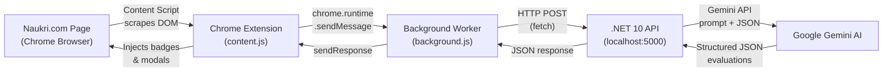
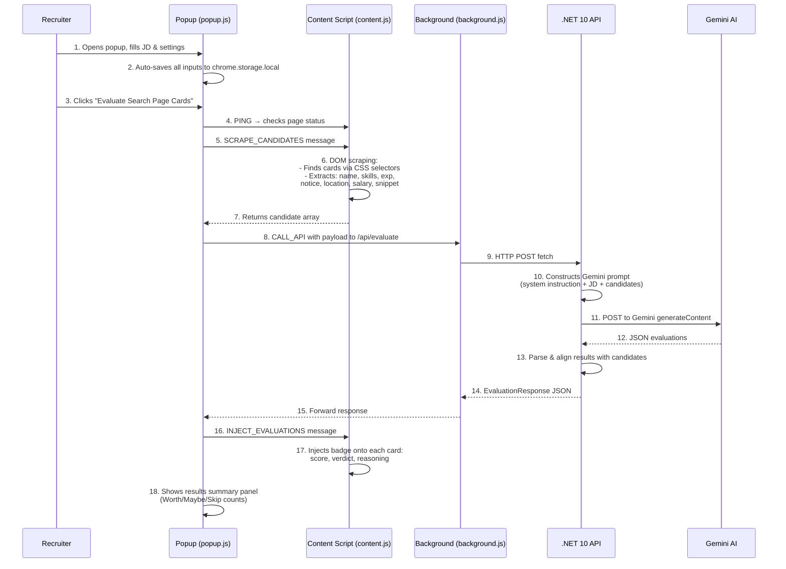
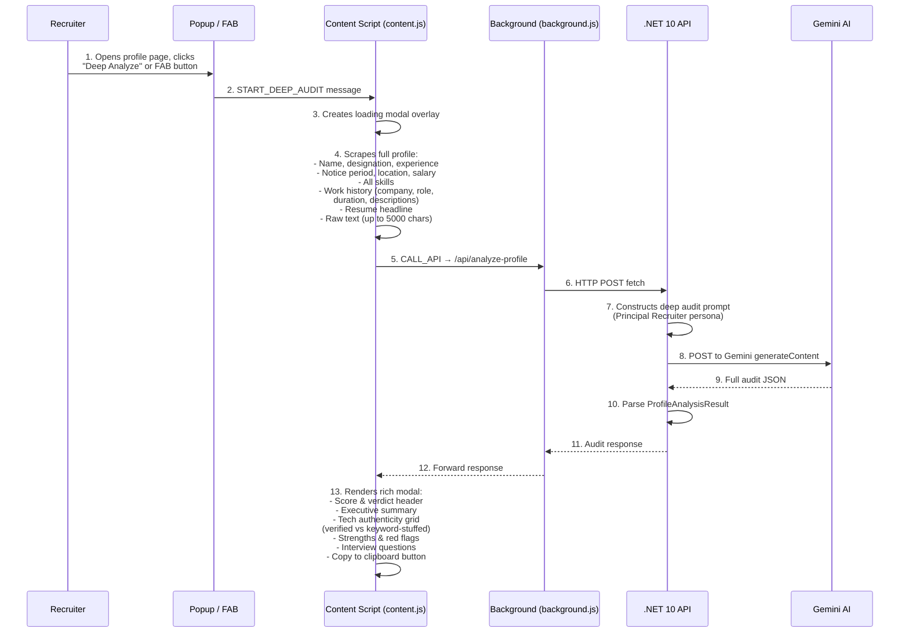

# Naukri AI Candidate Matcher — Complete Analysis & Workflow

## 🏗️ Architecture Overview

This is a **two-component system** that automates candidate screening on Naukri.com using AI:

| Component | Technology | Purpose |
|---|---|---|
| **Backend API** | .NET 10 Minimal API + Google Gemini AI | Receives candidate data, evaluates against JD using AI, returns structured JSON |
| **Chrome Extension** | Manifest V3 (JS/CSS/HTML) | Scrapes Naukri pages, sends data to backend, renders results on-page |



> [!IMPORTANT]
> The background service worker acts as a **proxy** to bypass Mixed Content (HTTPS → HTTP) and CORS blocks that would occur if the content script called `localhost` directly from `naukri.com`.

---

## ✨ All Features

### Feature 1: In-Page Candidate Card Screening (Batch Evaluation)

**What it does:** Evaluates all candidate cards on a Naukri recruiter search / applicant listing page and overlays AI-generated match badges directly onto each card.

**Evaluation criteria (sent to Gemini):**
- **Mandatory Skills match** — checks if skills/designation/snippet contain required skills
- **Notice Period knockout** — flags candidates whose notice period exceeds the max allowed
- **Experience alignment** — whether years of experience match the role's seniority
- **Location & salary** — extracted and sent as context

**Recommendation categories:**
| Verdict | Score | Badge Color |
|---|---|---|
| `WORTH OPENING` | ≥ 75% | ✓ Green |
| `MAYBE` | 50–74% | ⚡ Amber |
| `SKIP` | < 50% | ✕ Red |

Each card gets a visual badge injected with the score, verdict, and 1-2 sentence AI reasoning.

---

### Feature 2: Deep Profile & Career Technology Audit

**What it does:** Performs a comprehensive, resume-level analysis on an **opened candidate profile page**. This goes far beyond a simple skill match — it audits whether the candidate actually **used** claimed technologies in real projects.

**Audit dimensions:**
1. **Technology Authenticity** — For each mandatory skill, Gemini checks the employment history to determine:
   - `Primary / Production` — core tool used in actual projects
   - `Secondary / Ancillary` — used occasionally
   - `Keyword Stuffed / Not Evident` — listed in tags but no project evidence
2. **Career continuity** — tenure stability, progression, gaps
3. **Notice period knockout** — same as card evaluation
4. **Executive summary** — 2-3 sentence assessment
5. **Strengths & Red Flags** — bullet-pointed lists
6. **Targeted interview questions** — 2-3 tough probing questions for weak spots

**Verdict categories:**
| Verdict | Meaning |
|---|---|
| `WORTH GOING FORWARD` | Authentic hands-on usage, acceptable notice, strong impact |
| `BORDERLINE / INTERVIEW WITH CAUTION` | Partial depth, border notice, or 1 missing skill |
| `DO NOT PROCEED` | Core tech is keyword-stuffed, or severe knockout violation |

Results are shown in a **full-page modal overlay** with sections for executive assessment, tech audit grid, strengths/red flags, and interview questions. Includes a **Copy to Clipboard** button.

---

### Feature 3: Floating Action Button (FAB)

When the content script detects a **candidate profile page** (vs. a search listing), it automatically injects a floating `⚡ AI Deep Audit Profile` button on the page. Clicking it triggers the Deep Profile Audit directly without needing the popup.

---

### Feature 4: Popup UI with Settings

The extension popup ([popup.html](file:///c:/Users/HP/Downloads/Naukri_Automation-main/Naukri_Automation-main/naukri-extension/popup.html)) provides:
- **Page status indicator** — shows whether cards or a profile page is detected
- **Job configuration form:**
  - Target Job Title
  - Mandatory Skills (comma-separated)
  - Max Notice Period (days)
  - Full Job Description textarea
- **Two action buttons:**
  - 🔍 **Deep Analyze Opened Profile & Resume** — triggers Feature 2
  - ⚡ **Evaluate Search Page Cards** — triggers Feature 1
- **Collapsible settings drawer** — to configure the backend API URL with HTTP/HTTPS toggle
- **Results summary panel** — shows counts of Worth Opening / Maybe / Skip after card evaluation
- All inputs are **auto-persisted** to `chrome.storage.local`

---

### Feature 5: Intelligent Fallback (Rule-Based Local Evaluation)

When the Gemini API key is missing, a placeholder, or the API call fails, the backend **does not break**. Instead it falls back to a local rule-based evaluator:

**Card evaluation fallback logic ([GeminiService.cs:243–338](file:///c:/Users/HP/Downloads/Naukri_Automation-main/Naukri_Automation-main/NaukriMatcher.Api/Services/GeminiService.cs#L243-L338)):**
- Starts at score 50
- +up to 35 points for mandatory skill matches (proportional)
- +15 for quick availability (≤15 days notice)
- −35 for notice period knockout
- Clamped to 10–98 range

**Profile audit fallback logic ([GeminiService.cs:525–627](file:///c:/Users/HP/Downloads/Naukri_Automation-main/Naukri_Automation-main/NaukriMatcher.Api/Services/GeminiService.cs#L525-L627)):**
- Checks each mandatory skill against work history text vs. just skills tags
- Marks skills found only in tags as "Keyword Stuffed / Not Evident"
- Generates 3 default probing interview questions

---

### Feature 6: HTTP/HTTPS Quick Toggle & API Proxy

- The popup includes a one-click **HTTP ↔ HTTPS toggle** button to switch between `http://localhost:5000` and `https://localhost:5001`
- All API calls from both popup and content script go through the **background service worker** proxy ([background.js](file:///c:/Users/HP/Downloads/Naukri_Automation-main/Naukri_Automation-main/naukri-extension/background.js))
- If the background proxy fails, there's a **direct fetch fallback** as a safety net

---

### Feature 7: Local Test Pages

Two HTML mock pages are included for testing without a live Naukri recruiter account:
- [test-naukri-page.html](file:///c:/Users/HP/Downloads/Naukri_Automation-main/Naukri_Automation-main/naukri-extension/test-naukri-page.html) — simulates a search results page with candidate cards
- [test-candidate-profile.html](file:///c:/Users/HP/Downloads/Naukri_Automation-main/Naukri_Automation-main/naukri-extension/test-candidate-profile.html) — simulates an opened candidate profile

---

## 🔄 Complete Workflow — Step by Step

### Workflow A: Search Page Card Evaluation



### Workflow B: Deep Profile Audit



---

## 📁 Key Files Reference

| File | Role |
|---|---|
| [Program.cs](file:///c:/Users/HP/Downloads/Naukri_Automation-main/Naukri_Automation-main/NaukriMatcher.Api/Program.cs) | API entry point — 3 endpoints: health (`/`), evaluate (`/api/evaluate`), profile audit (`/api/analyze-profile`) |
| [GeminiService.cs](file:///c:/Users/HP/Downloads/Naukri_Automation-main/Naukri_Automation-main/NaukriMatcher.Api/Services/GeminiService.cs) | Core AI service — prompt engineering, Gemini API calls, JSON parsing, local fallback logic |
| [EvaluationDtos.cs](file:///c:/Users/HP/Downloads/Naukri_Automation-main/Naukri_Automation-main/NaukriMatcher.Api/Models/EvaluationDtos.cs) | All DTOs — request/response records for both card evaluation and profile audit |
| [content.js](file:///c:/Users/HP/Downloads/Naukri_Automation-main/Naukri_Automation-main/naukri-extension/content.js) | Content script — DOM scraping (cards + profiles), badge injection, modal rendering, FAB injection |
| [popup.js](file:///c:/Users/HP/Downloads/Naukri_Automation-main/Naukri_Automation-main/naukri-extension/popup.js) | Popup logic — form management, chrome.storage, triggers evaluation/audit workflows |
| [background.js](file:///c:/Users/HP/Downloads/Naukri_Automation-main/Naukri_Automation-main/naukri-extension/background.js) | Service worker proxy — routes HTTP calls from extension to local API |
| [manifest.json](file:///c:/Users/HP/Downloads/Naukri_Automation-main/Naukri_Automation-main/naukri-extension/manifest.json) | MV3 config — permissions, content script injection rules, host permissions |

---

## 🧠 AI Prompt Engineering Details

The system uses **two distinct Gemini prompts** with carefully crafted system instructions:

### Card Evaluation Prompt
- **Persona:** Expert Technical Recruitment Assistant
- **Temperature:** 0.2 (deterministic)
- **Output format:** `application/json` (enforced via `responseMimeType`)
- **Knockout rules baked into the prompt:** mandatory skills, notice period, experience alignment

### Deep Career Audit Prompt
- **Persona:** Principal Technical Recruiter and Engineering Architect
- **Primary objective:** Determine if required technologies were **actually used in production** vs. keyword-stuffed
- **Assigns depth levels** per technology: Primary / Production, Secondary / Ancillary, Keyword Stuffed
- **Generates probing interview questions** targeting identified weak spots

> [!TIP]
> Both prompts enforce strict JSON output with no markdown wrapping, and the backend includes a `CleanJsonString()` method that strips any ```` ```json ```` wrappers just in case.
